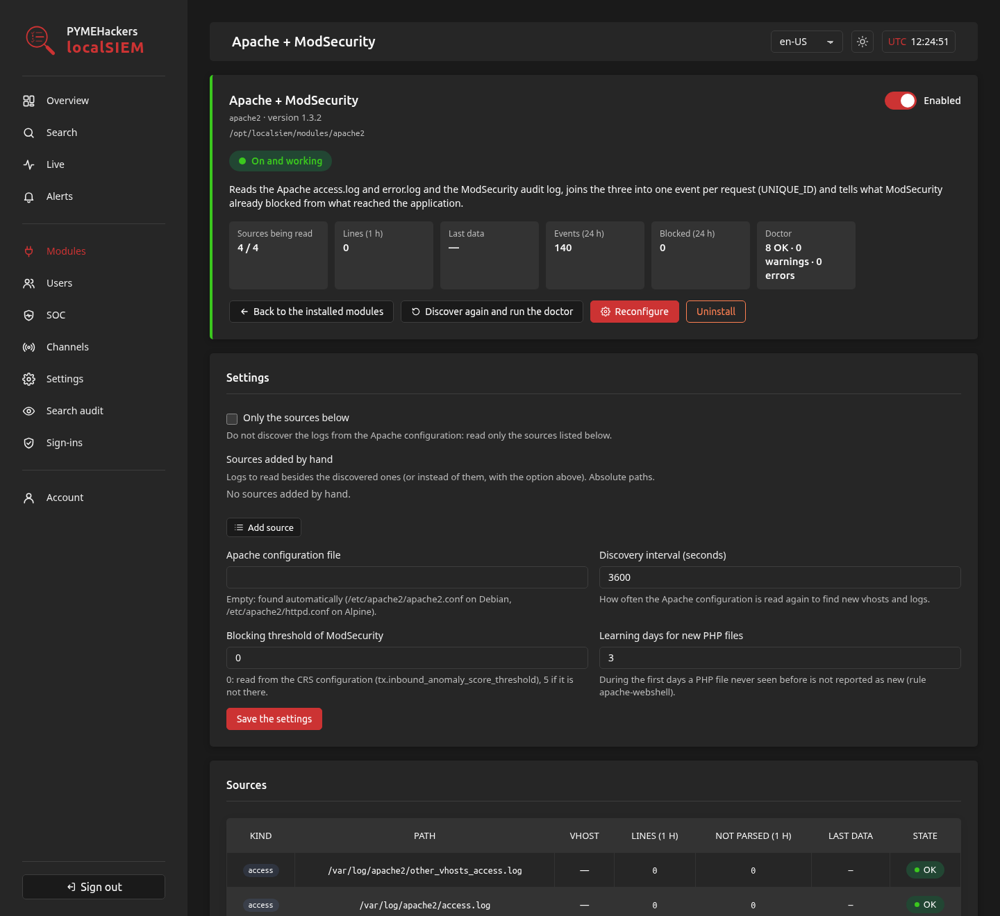

# localSIEM-modules

Questo README è disponibile anche in:\
[de-DE](README.de-DE.md), [en-GB](README.en-GB.md), [en-US](../README.md), [es-AR](README.es-AR.md), [es-ES](README.es-ES.md), [fr-FR](README.fr-FR.md), [he-IL](README.he-IL.md), [hi-IN](README.hi-IN.md), it-IT, [ja-JP](README.ja-JP.md), [ko-KR](README.ko-KR.md), [pt-BR](README.pt-BR.md), [pt-PT](README.pt-PT.md), [ru-RU](README.ru-RU.md), [zh-CN](README.zh-CN.md)

## Che cos'è

I moduli di [localSIEM](https://github.com/PYMEHackers/localSIEM), il SIEM leggero che funziona sullo stesso server che protegge. Ogni modulo gli insegna un servizio del server: dove sono i suoi log, come leggerli e quali regole si applicano. Oggi ce ne sono due:

- **apache2** (Apache + ModSecurity): unisce l'access log, l'error log e il log di audit di ModSecurity di ogni richiesta, con regole per brute force, enumerazione, file sensibili, web shell ed errori del database.
- **privesc** (Escalation dei privilegi): sorveglia ciò che viene eseguito sul server (auditd, sudo, su, pkexec, doas, snoopy) e segnala i passi di un'escalation a root.

Un modulo non installa mai nulla sul server: lavora con ciò che il server ha già.

## Schermate



## Installazione

I moduli si installano dall'interfaccia web di localSIEM. Prima installa localSIEM, come `root`:

**Debian 13**:

```bash
curl -fsSL -H 'Accept: application/vnd.github.raw+json' https://api.github.com/repos/PYMEHackers/localSIEM/contents/deploy/install-update-reinstall-debian.sh | bash -s -- --install --allow-from 203.0.113.10
```

**Alpine Linux 3.24**:

```bash
apk add bash curl && curl -fsSL -H 'Accept: application/vnd.github.raw+json' https://api.github.com/repos/PYMEHackers/localSIEM/contents/deploy/install-update-reinstall-alpine.sh | bash -s -- --install --allow-from 203.0.113.10
```

`--allow-from`: gli IP autorizzati ad aprire l'interfaccia web (`https://<server>:10443`).

Poi, nell'interfaccia web, apri **Moduli › Installabili**, premi **Controlla il repository**, guarda **Requisiti** e premi **Installa** sul modulo.

## Leggi la documentazione

Esplora:

- [doc/MANUAL.it-IT.md](MANUAL.it-IT.md) per imparare a installare, configurare e usare ogni modulo.
- [doc/CODE.it-IT.md](CODE.it-IT.md) per capire come sono costruiti e come scriverne uno nuovo (per sviluppatori e per modelli di IA).
